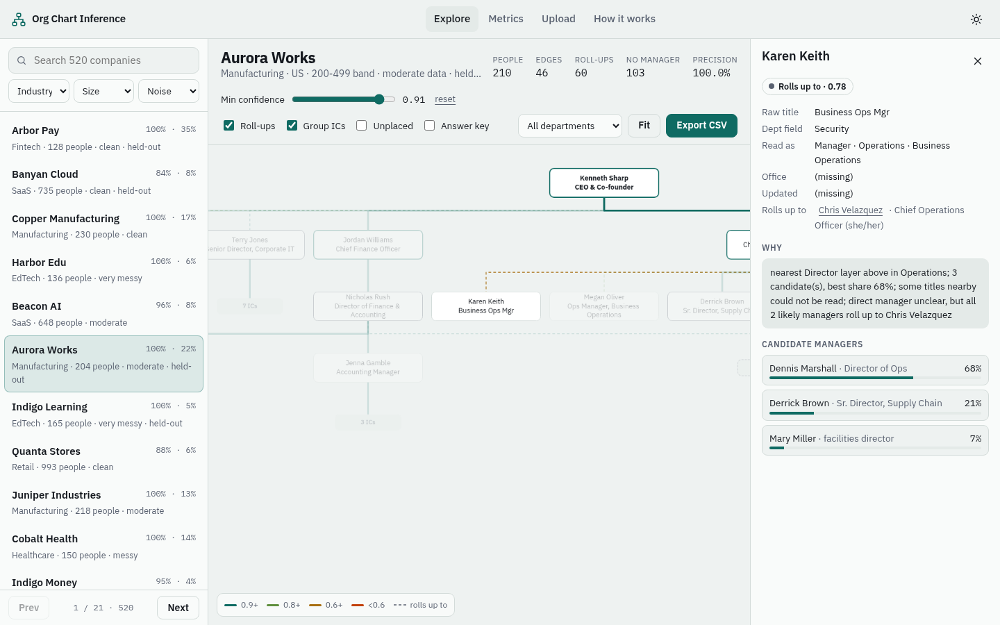
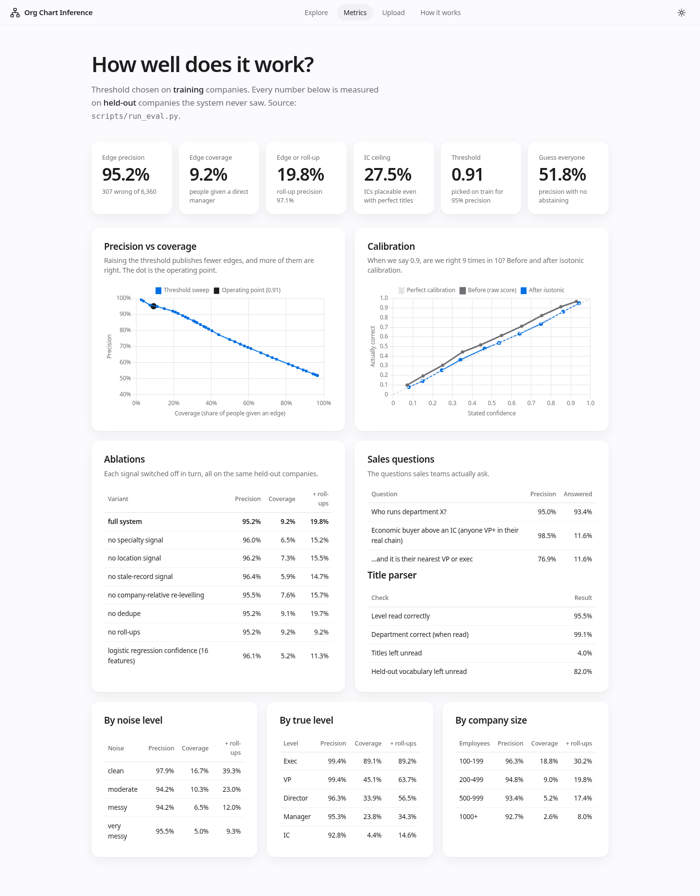

# Org Chart Inference

Turn a flat list of people and job titles into a reporting tree for each company, with a calibrated confidence on every edge. **A wrong edge is worse than no edge**, so the system abstains when it isn't sure. When the direct manager is ambiguous but everyone who could be the manager reports to the same person, it publishes a weaker "rolls up to" link instead.

- **Live demo:** https://org-chart-inference.onrender.com. It runs on free hosting, so the first load after a quiet spell takes about a minute while the server wakes up.
- **Spec:** [`docs/SPEC.md`](docs/SPEC.md) · **Walkthrough:** [`docs/WALKTHROUGH.md`](docs/WALKTHROUGH.md) · **Build log:** [`BUILD_LOG.md`](BUILD_LOG.md)



## Results at a glance (held-out test companies)

Numbers are pasted from `reports/metrics.json`, produced by `python scripts/run_eval.py` (seed 42). The threshold was chosen on the 312 training companies and is reported on the 208 test companies.

| Metric | Value |
|---|---|
| **Edge precision** at the operating threshold (0.91) | **95.2%** (6,053 right, 307 wrong, of 6,360 edges) |
| Coverage: direct edge / edge **or** roll-up / IC ceiling | **9.2%** given a direct manager · **19.8%** answered by an edge or a roll-up · **27.5%** of ICs are identifiable at all from titles (see below) |
| Roll-up ("rolls up to") precision | 97.1% |
| Naive baseline: always pick the top candidate | 51.9% precision at 96.7% coverage |
| "Who runs department X?" | 95.0% precision, 93.4% answered |
| "Economic buyer above this IC" (a VP or exec in their real chain) | 98.5% precision, 11.6% answered |
| Calibration | Within about 2 points of the diagonal in every bin (see the chart below) |
| Title parser, level read correctly | 95.5% (department correct 99.1% when it's read) |

**By level**, edges are dense where they matter most for sales: execs reach 99.4% precision at 89% coverage, VPs 99.4% at 45%, directors 96.3% at 34% (57% including roll-ups), managers 95.3% at 24%, and ICs 92.8% at 4% (15% including roll-ups).

**Why IC coverage is low, and why that's right.** Even with *perfect* parsing, only **27.5%** of ICs have a manager who is the only person in the company with their department, level and team (**39.4%** if you add the office). This is from `scripts/identifiability.py`, which uses the answer key. So for most ICs, "Senior Backend Engineer" alone cannot tell you which of three Backend managers they report to. The system says so instead of guessing, and gives the roll-up when there is one.

## Quick start

```bash
python -m venv .venv && source .venv/bin/activate
pip install -r requirements-dev.txt
python scripts/generate_data.py        # 520 companies, ~203k records -> data/*.parquet (~11 s)
python scripts/run_eval.py             # metrics + ablations -> reports/metrics.json (~6 min, --no-ablations for ~1 min)
python scripts/build_app_data.py       # per-company JSON for the UI -> data/app/
pytest -q                              # 33 tests
uvicorn app.main:app --reload          # open http://127.0.0.1:8000
```

The precomputed dataset, metrics and app files are committed, so `pip install -r requirements.txt && uvicorn app.main:app` is enough to run the app.

## The problem, in plain words

Sales teams ask questions like "who runs data here?", "who does the Head of Security report to?" and "who is the economic buyer above my champion?". All we have per company is a list of people with titles (often messy) and sometimes a department and an office. We have to infer the tree, and know when we can't.

## Approach

```
generator ──► people.parquet (messy, flat)          truth.parquet (answer key, never read by inference)
                 │                                          │
                 ▼                                          │
   1. parse titles (rules + RapidFuzz typo repair)          │
   2. dedupe records, re-level relative to the company     │
   3. candidates = nearest layer above in the same dept    │
      (else the exec who usually owns that dept, else CEO) │
   4. score: team, office, stale record, title quality     │
   5. calibrate (isotonic, train companies only)           │
   6. emit edge if conf ≥ 0.91, else abstain               │
   7. roll-up if all plausible managers share an ancestor  │
                 │                                          │
                 ▼                                          ▼
          predictions ──────────────► evaluate.py: precision, coverage, calibration, ablations
                 │
                 ▼
     FastAPI + static UI (Cytoscape chart, threshold slider, metrics, CSV upload/export)
```

### 1. Data: generate the truth first, then add the mess
The generator ([`orgchart/generator.py`](orgchart/generator.py)) builds a **real tree** for each company and only then flattens it:

- **Mix:** 9 industries with different department weights (Manufacturing is Operations-heavy, SaaS is Engineering- and Sales-heavy), 6 countries with locale-aware names from Faker and real office cities, and 4 size bands (228 / 179 / 84 / 29 companies at 100–199 / 200–499 / 500–999 / 1000+ people, median 246).
- **Shape:** CEO, then execs, VPs, directors, managers and ICs. Bigger companies get more layers and more execs. Some departments have no exec of their own and report to another one (Data under the CTO or CFO, Customer Success under the CRO or COO, and so on). Spans of control are uneven.
- **Noise** comes in four levels (clean / moderate / messy / very messy): synonyms and abbreviations ("VP Eng", "Vice-President, Engineering", "SVP Global Sales"), typos, casing, junk ("| We're hiring!", pronouns, "@ Company"), missing titles, missing or **wrong** HR departments, missing offices, team names dropped from manager titles, duplicates, contractors, and **stale records** of people who have left (some with recent-looking dates, so the date alone can't catch them).
- **Real ambiguity is kept on purpose:** "Product Manager" is an IC while "Group Product Manager" manages people, "Brand Manager" and "Senior Counsel" can be either, "CPO" can mean Product or People, and "Head of X" can sit at VP or director level.
- **A held-out vocabulary** of titles in other languages and quirky titles ("Teamleiter", "Code Ninja", "Member of Technical Staff") that the parser was never written for. It tests generalisation honestly: 82% of these stay unread, so the system abstains and makes no wrong edges on them.
- **The answer key** (`truth.parquet`) has the true manager, level, department, team, stale and duplicate flags. Inference never reads it.

### 2–7. Inference
- **Parser** ([`orgchart/titles.py`](orgchart/titles.py)): ordered keyword rules, an abbreviation map and RapidFuzz typo repair against its *own* vocabulary. It is written separately from the generator, so it can't simply memorise the generator's tables.
- **Candidates:** the nearest *existing* layer above the person in the same department. This adapts to company shape: in a 120-person startup with no VPs, a director reports straight to the exec. If the department has no leader above, the candidates are the execs who usually own it (a small hand-set prior) plus the CEO.
- **Scoring:** same team ×4, a different team ×0.25, same office ×2, a different office ×0.5, a stale candidate ×0.35, scaled by how sure we are of the candidate's level. The best candidate's **share** of the total weight is the core of the confidence. Records we couldn't read in the same department add a "phantom" weight, because one of them might be the real manager.
- **Confidence** = share × √(title quality) × stale penalty, then **isotonic calibration** fitted on training companies.
- **Abstain** below 0.91. **Roll up** if every plausible manager (weight ≥ 25% of the best) reaches the same ancestor through published links.
- **Every edge has a reason**, shown in the app, for example: *"nearest Director layer above in Sales; same team (Mid-Market); same office (Denver); 6 candidate(s), best share 66%"*.

## Decisions & trade-offs

| Decision | Alternatives considered | Why this one | Trade-off |
|---|---|---|---|
| **Truth-first synthetic data with a held-out answer key** | Hand-label a few charts, or have an LLM write people lists | You can only measure precision if you know the right answer. A tree you built yourself gives an exact key for 200k people | Synthetic patterns aren't real ones, so the model may learn generator quirks. That's why the parser vocabulary is kept independent and held-out titles exist |
| **Rules first, no LLM for edges** | An LLM picking managers; graph ML | Edges must be exact and auditable. Rules are cheap, explainable and can't hallucinate a manager. This matches how I build in production: deterministic checks for anything that must be exact, LLMs for explaining and connecting context | Rules miss what they weren't written for (82% of held-out titles stay unread). The optional LLM hook can only parse titles and never creates an edge |
| **Nearest existing layer, not fixed levels** | Fixed rule such as "IC reports to Manager" | Companies differ: startups skip layers, and a "Head of" can be a VP | Misreading one manager's level shifts their reports to the wrong layer. Calibration absorbs part of this |
| **Confidence = candidate share, then isotonic calibration** | Logistic regression over 16 features (built and tested) | At the 95% precision target, the 3-factor score plus isotonic gives **9.2%** coverage. The logistic model gives **5.2%**, because it optimises average log-loss rather than the high-confidence head | The heuristic is hand-shaped. Calibration fixes its scale, not its ranking |
| **Operating point: the lowest threshold with ≥ 95% precision on train** | Maximise F1; a fixed 0.5 | "A wrong edge is worse than no edge" means precision first. Maximising F1 would push the threshold down to 0.25, which means 62% precision: about 4 in 10 published edges wrong | Coverage is low for ICs (see identifiability above) |
| **Roll-ups ("rolls up to") instead of guessing** | Guess the top candidate; leave it blank | Sales mostly needs the economic buyer and the department head, and a skip-level link answers that without a wrong direct edge. It doubles the people answered (9.2% → 19.8%) at 97.1% precision | Two kinds of link to explain in the UI. A dashed line means "somewhere under this person" |
| **Stale-record signal** (no update for 18+ months) | Ignore dates | Leavers should get no edge and should not "steal" reports | It also penalises current staff with old profiles. The ablation shows it is still the biggest single win (coverage 5.9% → 9.2%) |
| **Phantom candidates for unreadable titles** | Ignore unreadable records | An unreadable title nearby might be the real manager, so confidence should drop | A small coverage cost |
| **Split by company (60/40), calibrate and threshold on train only** | Random split by person | People in one company are correlated, so splitting by company avoids leakage | Fewer companies to calibrate on |
| **FastAPI + static SPA, precomputed per-company JSON** | Streamlit; React with a build step | A custom interactive chart (Cytoscape + dagre), no Node build, fits easily in Render's free 512 MB (about 150 MB RSS after an upload) | Plain JS and hand-written CSS (no Tailwind, no bundler), so more code to own by hand |

## How we measured it

- **Edge precision** = correct published edges ÷ published edges. This is the headline metric. Edges given to people who have no manager (the CEO, or someone who has left) count as wrong.
- **Coverage** = published edges ÷ people who truly have a manager. **Recall** = correct edges ÷ the same. F1 is reported but not optimised.
- **Roll-up precision**: a roll-up is right if the target is a true ancestor of the person.
- **Calibration** (reliability diagram): edges are binned by stated confidence and compared with how often each bin is right, before and after isotonic calibration.
- **Precision vs coverage curve** across thresholds, with the operating point marked. For example: 0.80 gives 90.7% precision at 22.2% coverage, 0.90 gives 95.0% at 11.2%, and 0.95 gives 98.4% at 3.8%.
- **Breakdowns** by noise level, company size, industry, true level, contractors and held-out titles.
- **Sales questions**: "who runs department X?" (the single top-level person in the department) and "the economic buyer above this IC" (the first VP or exec on the predicted chain, checked against the true chain).
- **Ablations**: each signal switched off, with threshold and calibration refitted each time, all scored on the same test companies.
- **Duplicates** are scored fairly: pointing at a duplicate record of the true manager counts as correct.

| Ablation (test) | Precision | Coverage | + roll-ups |
|---|---|---|---|
| **Full system** | **95.2%** | **9.2%** | **19.8%** |
| No team (specialty) signal | 96.0% | 6.5% | 15.2% |
| No office signal | 96.2% | 7.3% | 15.5% |
| No stale-record signal | 96.4% | 5.9% | 14.7% |
| No company-relative re-levelling | 95.5% | 7.6% | 15.7% |
| No dedupe | 95.2% | 9.1% | 19.7% |
| No roll-ups | 95.2% | 9.2% | 9.2% |
| Logistic regression confidence (16 features) | 96.1% | 5.2% | 11.3% |

| Noise level | Precision | Coverage | + roll-ups |
|---|---|---|---|
| Clean | 97.9% | 16.7% | 39.3% |
| Moderate | 94.2% | 10.3% | 23.0% |
| Messy | 94.2% | 6.5% | 12.0% |
| Very messy | 95.5% | 5.0% | 9.3% |

Precision holds steady as noise rises. The system answers less instead of answering wrong, which is the behaviour we want.



## The app

- **Explore:** search and filter 520 companies (only one chart is drawn at a time). The chart shows edge colour and width by confidence, dashed roll-ups, and dashed outlines for people with no confident manager. ICs are grouped under each manager (click to expand). A **threshold slider** re-filters edges live, an **Answer key** toggle marks wrong edges in red, and there is a department filter, CSV export, and dark and light themes.
- **Click anyone** to see their raw title, how it was read, the reason for their edge, and the **competing candidate managers with their shares**.
- **Metrics:** the precision-coverage curve, the calibration chart, ablations, breakdowns, sales questions and parser accuracy.
- **Upload:** a CSV for one company (`title` required; `full_name`, `department`, `location`, `last_updated` optional; up to 3,000 rows) goes through the same pipeline and calibration. Download the result as CSV. `data/sample_upload.csv` is an example.
- **API:** `/health`, `/api/companies?q=&industry=&size=&noise=&page=`, `/api/company/{id}`, `/api/company/{id}/export.csv?threshold=`, `/api/metrics`, `/api/calibration`, `POST /api/infer`, with docs at `/api/docs`.

## Reuse: what I didn't build

I searched GitHub and the web first (org-chart inference, title normalisation and seniority, title taxonomies). Nothing does title-only reporting-line inference, so the inference is original. Mature libraries do the commodity work, and **no third-party code is copied**. Details are in [`THIRD_PARTY_NOTICES.md`](THIRD_PARTY_NOTICES.md).

| Reused | For | Licence |
|---|---|---|
| Faker | Locale-aware names | MIT |
| RapidFuzz | Typo repair, near-duplicate titles | MIT |
| pandas, NumPy, PyArrow | Data handling | BSD / Apache-2.0 |
| FastAPI, Uvicorn, python-multipart | API and server | MIT / BSD / Apache-2.0 |
| Cytoscape.js + dagre, Chart.js | Chart, layout, charts | MIT |

Considered and not used: `find-job-titles` (extracts titles from text, which we don't need), a MIT seniority classifier on Hugging Face (needs sentence-transformers, too heavy for 512 MB, and covers seniority only), `job_title_ner` (its training data has separate terms), `org_chart_helper` (GPL and needs existing reporting lines), and O*NET (occupations, not hierarchy).

## How I built it (AI-native dev loop)

<!-- SHREY: personalise this section in your own voice. Keep it true to what you actually did. -->
- **Spec first.** [`docs/SPEC.md`](docs/SPEC.md) was written before any code, with non-negotiables and acceptance criteria. Coding agents implemented it in small steps, and each step was checked against the spec and the eval numbers. My lesson from building Kiwi Control and Dasha holds here too: vague prompts produce drift, and precise specs produce shippable code.
- **Shared agent context in the repo:** [`AGENTS.md`](AGENTS.md) and [`CLAUDE.md`](CLAUDE.md) hold the same rules, so every tool starts from the same context (never read the answer key in inference, numbers only from runs, keep it small).
- **The eval is the feedback loop.** Every change to inference was judged by `scripts/run_eval.py`, never by eyeballing. Error analysis on high-confidence wrong edges drove the fixes, for example `EM - Backend` being parsed as an IC. The logistic-regression idea was built, measured and rejected.
- **Clean history:** small commits that tell the story (`git log --oneline`), plus [`BUILD_LOG.md`](BUILD_LOG.md).
- `<SHREY: add your Kiwi Control workflow here, e.g. checkpoints, review packs and handoffs you used, with a screenshot or short Loom link.>`

## Limitations (honest list)

- **Synthetic data.** Real data has patterns the generator doesn't model: matrix orgs and dotted lines, acquisitions with two parallel trees, interim titles, and the same title meaning different levels in different industries.
- **IC coverage is low by design.** Titles alone rarely identify an IC's manager, so in production you'd add other signals (below).
- **Hand-set priors** for which exec owns which department. In production these would be learned from a few hundred labelled charts.
- **The parser is English-first.** The held-out multilingual titles mostly stay unread. The LLM fallback hook exists but is off and has no provider wired in.
- **Calibration is fitted on synthetic data.** On real data it would be refitted on a labelled sample.

## Next steps

1. **More signals:** tenure and start dates (managers usually join before their reports), email and Slack co-occurrence, LinkedIn "reports to" when public, and team names in profiles. Each slots in as another multiplier in scoring and is measured with the same ablation harness.
2. **A small labelled set of real charts** to refit priors and calibration, and to check how far synthetic results carry over.
3. **An LLM as a parser fallback and an explainer only:** cached per unique title, its output capped at 0.6 confidence, and never allowed to create an edge.
4. **Scale:** the inference is per company and has no cross-company state, so it maps directly onto Spark or Databricks with `groupBy(company_id).applyInPandas(infer_company)`, incremental runs for changed companies only, and SCD2 history of edges so the chart can be tracked over time.

## Hosting (Render free tier)

`render.yaml` defines one free Python web service: `pip install -r requirements.txt`, then `uvicorn app.main:app --host 0.0.0.0 --port $PORT`, with a `/health` check. Results are precomputed and committed, so nothing heavy runs at build or boot. Each company's chart is a ~25 KB gzipped JSON loaded only when opened. **Free instances sleep after about 15 minutes of inactivity, and waking takes about a minute.** The app shows a "waking up" loader while that happens.

**Pushing (the repo is private):**

```bash
gh repo create sonishrey9/firmable-org-chart-inference --private --source . --push
```

Render can deploy a private repo once its GitHub app has access to it: in Render, go to New → Blueprint, connect GitHub, and grant the Render app access to `firmable-org-chart-inference` (either "Only select repositories" or all of them). Render then reads `render.yaml`. Reviewers who need the code must be added as collaborators. The live demo URL works without that.

## Repo layout

```
orgchart/      generator.py · titles.py · infer.py · calibrate.py · evaluate.py · llm_fallback.py
scripts/       generate_data.py · run_eval.py · build_app_data.py · identifiability.py
app/           main.py (FastAPI) · static/ (index.html, app.js, styles.css)
data/          companies/people/truth parquet (seed 42) · app/ (per-company JSON) · sample CSVs
reports/       metrics.json · confidence_model.json
docs/          SPEC.md · WALKTHROUGH.md · screenshots/
tests/         pytest: parser, generator invariants, inference, API
```
