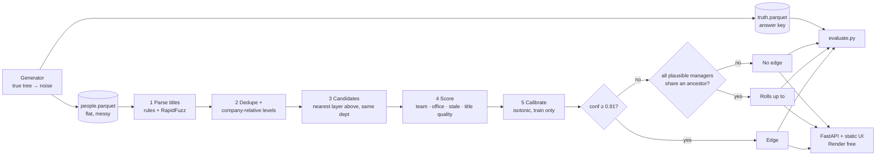

# Walkthrough (1 page, for presenting)

## The 30-second pitch
"For every company we only have people and titles. I generate companies whose true org chart I know, flatten them, and make the data messy. Rules read each title and pick candidate managers from the nearest layer above in the same department. A calibrated score gives each reporting line a confidence. Below 0.91 we publish nothing, because a wrong edge is worse than no edge. If we can't pick the direct manager but everyone who could be the manager reports to the same person, we say 'rolls up to'. On 208 held-out companies: **95.2% edge precision**, 97.1% roll-up precision, and 'who runs this department' is 95.0% right on 93.4% of departments."

## Architecture

## Pipeline steps in plain words
1. **Generate:** build the real tree (CEO → execs → VPs → directors → managers → ICs) for 520 companies in 9 industries and 4 sizes, then add mess: synonyms, typos, missing fields, wrong departments, duplicates, contractors, leavers, and foreign titles the parser has never seen.
2. **Parse:** turn each title into a level, department and team. "Product Manager" is an IC, "Group Product Manager" is a manager, and "Solutions Engineer" is in Sales.
3. **Candidates:** the nearest layer that actually exists above the person, in their department. If the department has no leader, the exec who usually owns it.
4. **Score:** same team ×4, same office ×2, stale ×0.35. Confidence is the best candidate's share of the total.
5. **Calibrate:** isotonic regression on training companies, so that 0.9 really means about 90% right.
6. **Decide:** publish an edge, publish a roll-up, or abstain. Every edge carries a reason.

## The threshold choice
- Rule: **the lowest threshold where training precision is still ≥ 95%** → 0.91. Reported on held-out companies: 95.2%.
- What other thresholds would give (test): 0.80 → 90.7% precision / 22.2% coverage; 0.90 → 95.0% / 11.2%; 0.95 → 98.4% / 3.8%. Maximising F1 would choose 0.25 → 62% precision, which means about 4 in 10 edges wrong. That breaks the brief.
- The app's slider shows this trade-off live, and the answer-key toggle shows the wrong edges in red.

## 10 likely follow-up questions

1. **Why precision over recall?** The brief says a wrong edge is worse than no edge. A wrong "reports to" sends sales to the wrong buyer and destroys trust, while a missing edge just says "unknown". Roll-ups recover most of the sales value anyway.
2. **Why is IC coverage so low (4% direct, 15% with roll-ups)?** Titles alone rarely identify an IC's manager. Even with perfect parsing, only 27.5% of ICs have a uniquely identifiable manager (39.4% with the office). The rest need signals titles don't carry.
3. **How do you know the confidence means anything?** It is calibrated on training companies and checked on held-out ones. The reliability diagram is within about 2 points of the diagonal, and edges above 0.9 are right 95% of the time.
4. **Isn't synthetic data circular?** The risk is real, so the parser has its own vocabulary, there are held-out titles it was never written for (82% stay unread, so it abstains and makes no wrong edges), the split is by company, and the noise includes genuine ambiguities. Next step: refit on a small labelled real sample.
5. **Why not an LLM?** Edges must be exact and auditable. Rules are cheap, explainable and can't hallucinate a manager. An LLM is allowed only to help read titles the rules can't parse (cached and capped at 0.6), never to create an edge. It's the same split I use at work: deterministic for anything exact, LLMs for explaining and connecting context.
6. **Did you try a learned model?** Yes. A logistic regression over 16 features gave **5.2%** coverage at 95% precision, against **9.2%** for the simple score plus isotonic. It optimises average log-loss, not the confident head. I kept it as an ablation.
7. **Which signal matters most?** From the ablations, the stale-record date (coverage 9.2% → 5.9% without it), then team (→ 6.5%), office (→ 7.3%) and company-relative levels (→ 7.6%). Dedupe barely matters at this duplicate rate.
8. **How would this scale to 50M people and 5M companies?** Inference is per company with no shared state, so it maps onto `groupBy(company_id).applyInPandas(...)` on Spark or Databricks. Run it incrementally for companies whose people changed, and store edges as SCD2 so you can see history and diffs.
9. **What breaks first on real data?** Matrix orgs and dotted lines, two parallel trees after an acquisition, inconsistent seniority across industries, and stale profiles at scale. Each needs either a new signal or a "multiple managers" output.
10. **How would you add real signals?** Each one is another multiplier in scoring, measured with the same ablation harness: tenure and start dates (managers join before their reports), email and calendar co-occurrence, LinkedIn "reports to", and team names in profiles.

<!-- SHREY: be ready to show the Kiwi Control part of your dev loop and one high-confidence wrong edge, and explain why it happened. -->
